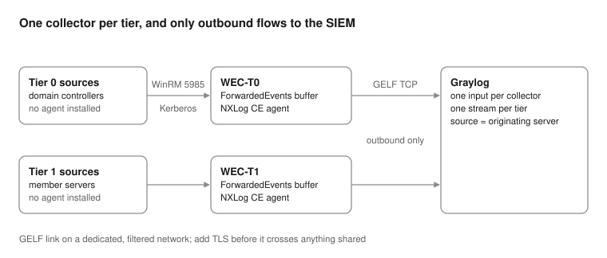

# Agentless DC logging under tiering: WEF/WEC, Graylog, and the traps the docs skip

We wanted the security logs of our domain controllers in one place without installing anything on tier 0. Windows Event Forwarding does that natively, and it works. It also has five ways of looking healthy while forwarding nothing. This is what a lab pilot taught us, with the command that proves each point.

> Everything below comes from a lab. Names, addresses and figures are fictitious or rounded.

## Why no agent on tier 0

A domain controller's Security log is a circular buffer. Once it wraps, the oldest events are gone, and anyone holding tier 0 rights can clear what is left. Availability monitoring tells you a DC is up. It does not tell you who added a member to Domain Admins last Tuesday.

The usual answer is a log shipper on every server. On tier 0 that means one more third-party service, running as SYSTEM, on the machines you least want to extend. Windows Event Forwarding (WEF) avoids that: the DC itself pushes selected events to a Windows Event Collector (WEC), and the only agent sits on the collector.

Microsoft's documentation for this fits in about three pages. Our own procedure went through several versions. The difference is this article.

## The architecture in four hops

1. **A GPO tells each source where its collector is.** One "Subscription Manager" GPO per tier, linked to the OU of the sources and never to the collector's (we did that once, and the collector dutifully subscribed to itself), filtered on a group such as `WEF-T0-Sources`.
2. **The source connects to the collector.** WinRM over HTTP/5985, authenticated with the computer account. Kerberos signs and encrypts the payload, so HTTP here does not mean clear text. Basic, Digest and `AllowUnencrypted` stay off.
3. **The collector hands out subscriptions and receives events.** The source filters its own logs and pushes batches (5 events or 30 seconds). Events land in `ForwardedEvents`, sized as a buffer (a few gigabytes), not as an archive.
4. **One agent on the collector ships to the SIEM.** We use NXLog Community Edition reading `ForwardedEvents` only, sending GELF over TCP to a Graylog input dedicated to that tier.



Domain controllers never talk to the SIEM directly: if Graylog stops, each collector keeps the events in its buffer.

Three rules keep this compatible with a tiering model:

- **One collector per tier.** A collector belongs to the highest tier it collects from and is administered only from that tier. Tiers never share a source group, a subscription, a Graylog input or a stream.
- **Flows only go one way.** Sources connect to the collector, the collector connects to Graylog. Graylog never opens a connection to a collector, and no remote-management agent runs there.
- **The collector's firewall lists the sources.** The WinRM inbound rule accepts only the addresses of the tier's source group. We derive the list from the group so nobody forgets a source:

```powershell
$Ips = Get-ADGroupMember -Identity "WEF-T0-Sources" |
    ForEach-Object { (Resolve-DnsName -Name "$($_.Name).corp.garbadrome.local" -Type A).IPAddress }
Set-NetFirewallRule -Name "WINRM-HTTP-In-TCP" -Enabled True -Profile Domain,Private -RemoteAddress $Ips
```

A source missing from that rule fails quietly: on the source, `Microsoft-Windows-Forwarding/Operational` logs event 105 (subscription manager unreachable) and nothing else tells you why.

## Trap 1: the forwarder cannot read the Security log

**Symptom.** On the collector, the source is `Active`, heartbeats arrive, `LastError` is 0. Not one Security event shows up.

**Cause.** Forwarding is done by the WinRM service on the source. By default that service has no read access to the Security channel.

**Fix.** Grant read access to the WinRM service SID in the channel's security descriptor, by GPO (*Computer Configuration > Administrative Templates > Windows Components > Event Log Service > Security > Configure log access*). The policy replaces the whole descriptor, so start from the one your DC reports and append one entry:

```text
(A;;0x1;;;S-1-5-80-569256582-2953403351-2909559716-1301513147-412116970)
```

That SID is the service SID of WinRM and is the same on every Windows machine.

Microsoft's own setup page tells you to add NETWORK SERVICE to *Event Log Readers*. On a member server that is a local group. On a domain controller it is a domain group: you would be granting read access to every log on every DC. On DCs, we did not follow that advice.

**The part that cost us an afternoon.** In our lab the source needed two reboots. After one reboot everything looked configured and nothing flowed. Our reading, which we have not proven: the policy is applied after the Event Log service has started, so the first reboot writes the new right and the second one makes the service use it. Setting the descriptor directly with `wevtutil sl` takes effect at once, which is how we handled the Sysmon channel.

**Proof.** Only the effective descriptor counts, not the GPO report:

```powershell
wevtutil.exe gl Security | Select-String "channelAccess"
```

The WinRM service SID must appear in the output.

## Trap 2: Active on the collector, refused on the source

**Symptom.** A subscription that reads several channels delivers events from some of them only. The collector reports nothing wrong.

**Cause.** If one channel of the query is unreadable, the source drops that channel and keeps the others. It says so, but only in its own log.

**Fix.** Read `Microsoft-Windows-Forwarding/Operational` on the source after every change:

```powershell
Get-WinEvent -LogName "Microsoft-Windows-Forwarding/Operational" -MaxEvents 30 |
    Format-Table TimeCreated, Id, Message -Wrap
```

| Event ID | Meaning |
| --- | --- |
| 100 | Subscription created: fine |
| 101 | Subscription created, but one of its channels is unreadable and is skipped |
| 102 | Subscription failed (code 5004: channel unreadable or missing) |
| 104 | Connected to the collector |
| 105 | Collector unreachable (DNS, firewall, address in the GPO) |

Every channel you forward needs a read entry for the forwarder, as Security does. Sysmon's channel was our second lesson: the collector showed the source as active, nothing arrived, and the source logged code 5004 at every attempt. Once we had added the read entry and restarted WinRM on the source, event 100 appeared within two minutes.

**Proof.** One event 100 per subscription, per source. Anything else is a source that looks alive and is not.

## Trap 3: the collector stops delivering and says nothing

**Symptom.** Every subscription is `Active` with `LastError: 0`. Heartbeats keep arriving. Test events exist in the source's local log and never reach the collector.

**What happened.** We had just disabled an old test subscription. From then on, the other subscriptions on that collector delivered nothing. The source did log event 103 (a subscription not unsubscribed cleanly), but do not read too much into it: the same DC logged it dozens of times in a few weeks, mostly around reboots, without any loss.

**Fix.** On the collector only:

```powershell
Restart-Service Wecsvc
```

The subscriptions re-activated and the events that had been waiting were delivered, each with its own time and record ID, so nothing arrived twice. We restarted neither WinRM nor the domain controller.

**Cause.** Unknown. We saw it once, and it followed the disabling of a subscription; we did not find why.

**Proof.** This is the incident that made the marker test (below) mandatory for us. Nothing on the collector distinguished this state from a healthy one.

## Trap 4: one event, one subscription

**Symptom.** Duplicates in the SIEM, or a subscription nobody dares to disable because nobody knows what else it carries.

**Cause.** Most likely overlapping queries. While two of our subscriptions both selected account-management events, we found thousands of events stored twice on the collector with the same record ID. We did not isolate the cause with a dedicated test. After the overlap was removed, a sample check found no duplicate.

**Fix.** One theme per subscription, and each event ID in exactly one of them. Our tier 0 runs about ten, one per theme: system, security changes, process creation, authentication, directory changes, weak Kerberos encryption, PowerShell script blocks, Sysmon and security policy processing. Each can be switched off alone.

The query language will fight you on three points:

- **Exact matches only.** `contains()` and `starts-with()` are not accepted in a subscription query. What you cannot filter at the source, you filter in the SIEM. Check how a value is really written, too: on the DCs we tested, a Kerberos encryption type appears as `0x17`, lower case, with no leading zero, and the filter matches nothing else.
- **Long lists are refused.** A long chain of `EventID=... or` fails at creation with WS-Man error `0x80338107`. Use ranges: `EventID >= 4720 and EventID <= 4767`.
- **Exclusions go in `Suppress`,** on an exact value. This is how two subscriptions share an event ID without overlapping: one suppresses what the other selects.

```xml
<QueryList>
  <Query Id="0" Path="Security">
    <Select Path="Security">*[System[(EventID=4702)]]</Select>
    <Suppress Path="Security">*[EventData[Data[@Name='TaskName']='\Microsoft\Windows\UpdateOrchestrator\Schedule Work']]</Suppress>
  </Query>
</QueryList>
```

Decide an exclusion after measuring, never before. An event suppressed at the source cannot be recovered later.

**Proof.** We compare the queries of all subscriptions with a script before enabling a new one. Our first version ignored `Suppress` elements and raised a false alarm on two subscriptions that were complementary by design. The second check is in the SIEM and is described below.

## Trap 5: the noise is your configuration

**Symptom.** One DC sends several times more events than its neighbours.

**Cause.** Not users, and not attackers. In our lab, over a few hours, one DC sent several times more Security events than the others, and about half of them were event 4702 (scheduled task updated) for a single Windows Update task rewriting itself.

**Fix.** Three corrections, in the order we found them:

1. **Sysmon registry monitoring.** Registry events were more than 90% of what Sysmon produced. About half came from one networking key written continuously; most of the rest were security settings rewritten at every policy refresh, logged even when the value did not change. Restricting it to the places where code gets launched (Run keys, service `ImagePath`, Image File Execution Options) cut registry events by about 99%.
2. **The self-rewriting task.** The `Suppress` shown above removes that one task by its full name. Other 4702 events stay: a scheduled task modified on a DC is exactly what you want to see.
3. **Policy refresh.** Our lab runs [HardenAD](https://github.com/LoicVeirman/HardenAD), an open-source hardening toolkit, adapted to the lab; in that setup it reapplies DC policies every five minutes. That is a design choice with a logging cost. It is also what made the failure in part 2 show up every five minutes.

**Proof.** In the SIEM, group by channel, then by event ID, sorted by count. Any line you cannot explain is either noise to remove or something you needed to know.

## Proving nothing is lost

A heartbeat proves the source talks to the collector. It does not prove that a single event gets through. The only proof we accept is a marker: a harmless, recognisable action on the source, found again at the far end.

1. **Produce the marker on the source.** With command-line auditing on, this creates an identifiable event 4688:

   ```powershell
   cmd.exe /c "echo WEF-TEST-$(Get-Date -Format yyyyMMdd-HHmmss)"
   ```

2. **Find it on the collector,** in `ForwardedEvents`, with the source's name in `MachineName`.
3. **Find it in the SIEM,** with the source's name in the `source` field.

We then cut the collector for about twenty minutes, longer than the heartbeat interval, while two flows were producing markers. Every marker arrived, and only once. The reason is simple: events stay in the source's own log, and the source resumes from the last event it delivered.

That also tells you where a loss would come from: a source log that wraps before the collector comes back. Size the source logs for the longest outage you accept. In our measurements `Microsoft-Windows-GroupPolicy/Operational`, at its default size, held only a few hours.

```powershell
wevtutil.exe sl "Microsoft-Windows-GroupPolicy/Operational" /ms:67108864
```

What we have not tested yet: an outage of the SIEM input itself. NXLog buffers to disk in that case (`pm_buffer`), and `ForwardedEvents` holds the rest, but we have not measured it.

## On the Graylog side

The shipper's configuration is short. The parts that matter:

```text
<Input windows_wec>
    Module        im_msvistalog
    Channel       ForwardedEvents
    SavePos       TRUE
    ReadFromLast  TRUE
    Exec          $collector = 'WEC-T0'; $tier = 'T0';
</Input>

<Output graylog_tcp>
    Module        om_tcp
    Host          192.0.2.50
    Port          12201
    OutputType    GELF_TCP
</Output>
```

Four things to know before you trust what you read in the SIEM:

- **`source` is the originating DC, not the collector.** NXLog takes it from the event's `Computer` field. We add `collector` and `tier` so we can still tell which path an event took.
- **Time is stored in UTC.** If events look exactly one hour off, fix the display time zone in the user profile. Never shift the time in the shipper or in a pipeline: the stored data would become wrong.
- **Precision is one second** with the Community Edition in our setup. For the exact order of events from one server, sort by `RecordNumber`.
- **Duplicates are easy to rule out.** For one source and one channel, group by `EventID` and compare `count()` with `card(RecordNumber)`. Equal values on every line mean no event arrived twice.

The link between collector and SIEM carries account names, command lines and PowerShell script content. Keep it on a dedicated, filtered network, and use TLS (`om_ssl` in place of `om_tcp`) as soon as it crosses anything shared.

## Checklist: adding a source

1. Add the computer account to the tier's source group.
2. On the collector, rerun the firewall command so the new address is allowed.
3. If the source is a DC, check that its copy of the Default Domain Controllers Policy matches the PDC's before you reboot it. Part 2 explains why.
4. Reboot the source twice.
5. Check `channelAccess` on the Security channel.
6. If the source is a DC, install Sysmon and check the descriptor of its channel as well.
7. Enlarge the local logs you rely on.
8. Validate: one event 100 per subscription, a marker found on the collector, the same marker found in the SIEM.

## What to remember

- An active subscription is not a working collection. Only a marker found at the far end proves it.
- The forwarder must be able to read every channel. That is the first cause of a source that is active and silent.
- One event, one subscription.
- Most of the noise comes from configuration, not from activity.
- In the SIEM, `source` is the originating server and time is stored in UTC.

## Next: the DC that stopped applying its security policy

While we were adding another DC to the pilot, one forwarding event kept coming back every five minutes. Nothing else looked wrong. Following it led us to a domain controller that had quietly stopped applying its security settings after a reboot, because one file carried a timestamp 11 seconds away from the PDC's copy. The file had been written five months earlier.

The only witness was the tool we were still installing. That story is part 2.

## References

- Microsoft Learn: [Setting up a source-initiated subscription](https://learn.microsoft.com/en-us/windows/win32/wec/setting-up-a-source-initiated-subscription)
- Microsoft Learn: [wecutil](https://learn.microsoft.com/en-us/windows-server/administration/windows-commands/wecutil)
- ANSSI (French national cybersecurity agency): [guide-journalisation-microsoft](https://github.com/ANSSI-FR/guide-journalisation-microsoft), scripts and standard queries for logging in an Active Directory environment
- NXLog Community Edition reference: [im_msvistalog](https://docs.nxlog.co/ce/current/index.html#im_msvistalog), [om_tcp](https://docs.nxlog.co/ce/current/index.html#om_tcp), [xm_gelf](https://docs.nxlog.co/ce/current/index.html#xm_gelf), [pm_buffer](https://docs.nxlog.co/ce/current/index.html#pm_buffer)
- Microsoft Sysinternals: [Sysmon](https://learn.microsoft.com/en-us/sysinternals/downloads/sysmon)
- HardenAD: [LoicVeirman/HardenAD](https://github.com/LoicVeirman/HardenAD), open-source Active Directory hardening toolkit
